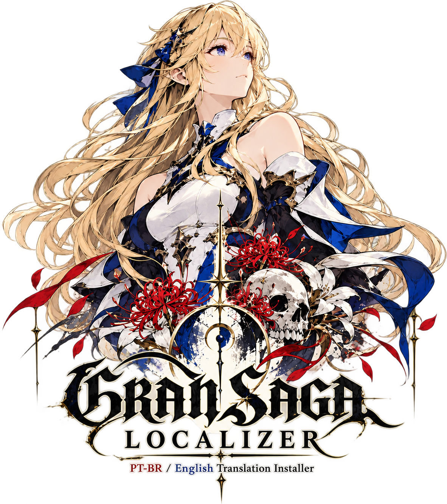
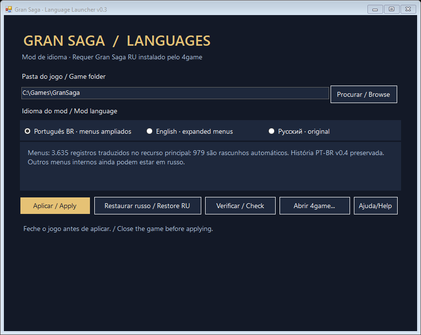

  

 

# Gran Saga Localizer

**TRADUÇÃO COMUNITÁRIA · PT-BR / ENGLISH · WINDOWS X64**

`v0.3 PREVIEW` · `CLIENTE RUSSO / 4GAME` · `TRADUÇÃO PARCIAL`

[**BAIXAR v0.3**](https://github.com/DridTy/GranSaga-Language-Launcher/releases/tag/v0.3.0-preview) · [INSTALAÇÃO](FIRST-RUN-CHECKLIST.md) · [LIMITAÇÕES](KNOWN-LIMITATIONS.md)

---

Instalador comunitário de **mod de idioma** para o cliente russo do Gran Saga no Windows x64.
Ele não baixa nem instala o jogo. Primeiro instale e atualize o Gran Saga RU pelo
**4game**, abra uma vez para baixar os dados iniciais e feche antes de aplicar.

## Menus ampliados

Os **3.611 registros com russo do recurso principal Game.locres** foram traduzidos
nos dois idiomas. Isso não significa todos os menus do jogo: outras tabelas internas
ainda podem apresentar russo.

| Idioma | Registros de interface alterados | Referências de interface | Rascunhos automáticos sem revisão completa |
|---|---:|---:|---:|
| Português brasileiro | 3.635 | 8.338 | 979 |
| English | 3.615 | 8.309 | 3.036 |

As traduções anteriores foram preservadas. Os textos novos usaram uma base automática
local, com revisão dos termos principais de menu. A ampliação precisa de revisão visual
no jogo. A história PT-BR v0.4 e a inglesa v0.2 foram mantidas e continuam parciais.

## Instalação

1. Instale/atualize o **Gran Saga RU pelo 4game** e abra uma vez até a tela inicial.
2. Feche o jogo e extraia **todo** o ZIP do mod.
3. Execute `GranSagaLanguages.exe`, selecione a instalação real e clique em **Verificar**.
4. Escolha o idioma, clique em **Aplicar** e aguarde a confirmação.
5. Abra pelo **4game**. Não é preciso trocar idioma no jogo nem editar INIs manualmente.

Requer Windows x64 e **.NET Framework 4.8 ou superior**. Não exige Python, modelos
de tradução, compilador nem ferramentas de PAK. O arquivo `Iniciar-Launcher.cmd`
verifica o .NET se necessário. Mantenha EXE, config, manifesto e patches juntos.

Use **Restaurar russo** para voltar ao original. É possível atualizar diretamente
sobre os mods anteriores compatíveis. Versões desconhecidas, dados ausentes e
assinaturas inválidas são recusados com orientações. Os backups ficam ao lado do PAK.

## Detalhes

- [Checklist de primeira instalação](FIRST-RUN-CHECKLIST.md)
- [Cobertura e limitações](KNOWN-LIMITATIONS.md)
- [Resultados dos testes](TEST-RESULTS.txt)
- [Validação dos pacotes](PACKAGE-VALIDATION.json)
- [Fila de revisão das traduções](translations/review-queue.json)

O instalador preserva a assinatura original, executáveis, vozes e região do jogo.
Não solicita dados de login. Os testes usam uma instalação fictícia; a abertura
com um perfil de jogo totalmente novo ainda precisa de revisão dentro do jogo.

## Desenvolvimento

Execute `Build.ps1` no Windows para compilar. Fontes C# em `src/`, memórias de tradução
em `translations/` e patches compactados em `patches/`. Modelos e bibliotecas usados
na preparação não estão incluídos na distribuição.

Projeto de fãs, sem vínculo oficial com Gran Saga ou 4game.
